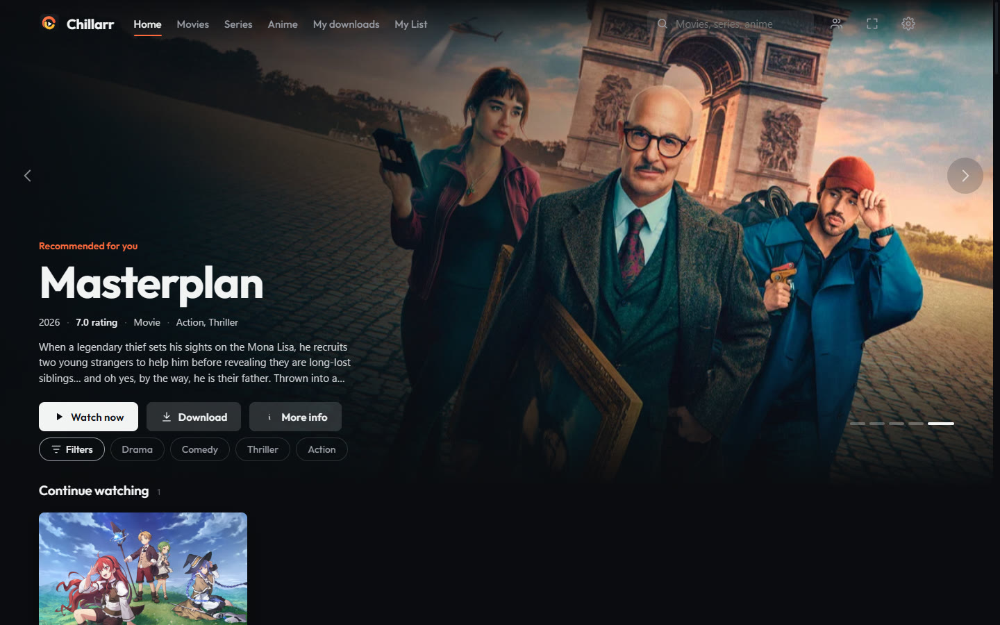
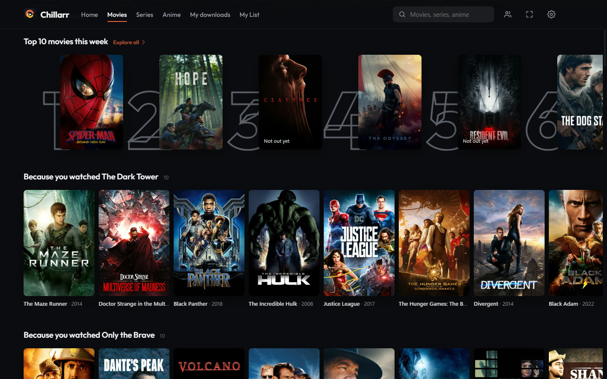
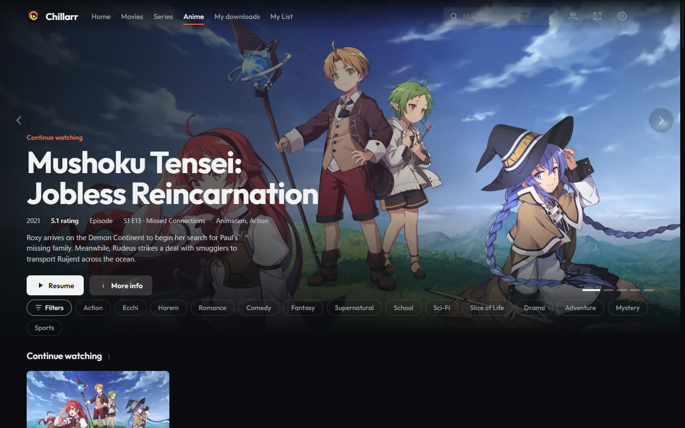
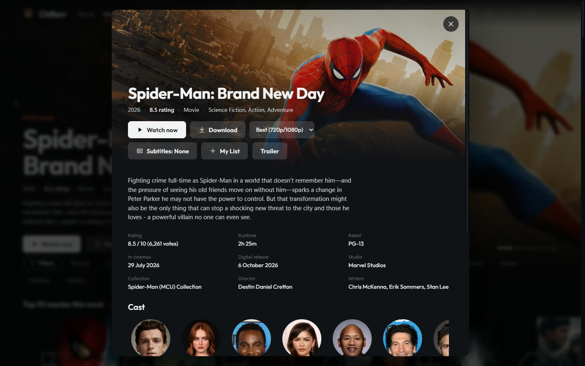

<div align="center">


# Chillarr

**Your own Netflix, running on your own PC.**

Movies, series and anime in one place. Find something, press Download or Watch now, and Chillarr does the rest.
It runs Jellyfin, Sonarr, Radarr, Prowlarr and qBittorrent for you, so you never have to open them.

[](LICENSE)



</div>

## What you get

### Browse like a streaming service

Home, Movies, Series, Anime, My downloads and My List. A Top 10 for the week, rows for every genre, trailers on hover, and "Because you watched" picks based on what you finished.



### Anime has its own home

Anime gets its own tab, with genres and tags from AniList, and goes into its own folder so it never mixes with your normal series.



### Download or watch right away

Open any title to see the rating, cast, runtime and trailer.

- **Download** sends it to Radarr or Sonarr. Pick the quality, or pick single seasons and episodes of a show.
- **Watch now** starts playing while it downloads.
- **My List** saves it for later.



### A proper player

- Picks up where you left off, on any device.
- Skip intro, and Up next at the end of an episode.
- Subtitles download by themselves, and Chillarr fixes their timing by listening to the audio.
- Volume up to 300%, subtitle delay keys, and big on-screen notes like VLC.
- Prefer VLC? Play the original file there instead.

### Every screen in the house

Chillarr's look also runs inside Jellyfin's own web pages. That means your phone and TV get it too, through the Jellyfin app, on your Wi-Fi or from anywhere through [Tailscale](https://tailscale.com) (Chillarr finds your Tailscale address by itself).

- **Profiles** for everyone, each with its own history and list, and an optional PIN.
- **Watch together** keeps two screens in sync.
- **Phone remote** controls the PC or TV from your phone with a short code.

### It keeps itself running

- **Fix everything.** One button starts whatever is down, tests every indexer and clears old failed marks, then tells you in plain words what still doesn't work.
- **Keeps watch** from the tray and brings things back when they stop.
- **Installs what's missing**, after asking, from each app's official source.
- **Cleans up** (optional): removes watched episodes after a few days so your disk doesn't fill up.
- **Skips huge disc copies and foreign dubs**, so downloads stay a sensible size and in the right language.

## Install

You need Windows 10 or 11.

Releases are on the way. Until then, build it yourself (see [Build](#build)).

The first time you open Chillarr, setup asks where movies, series and anime go, sets up Jellyfin, and installs whatever is missing.

## What it changes on your PC

Chillarr only changes things when you press Fix everything or Install. It asks Windows for permission (UAC) when a change needs it.

| When | What |
|---|---|
| An app isn't running | Starts it. Apps installed as services may need a UAC prompt. |
| Allowed Hosts is empty in Sonarr or Radarr | Sets it to this PC's names (localhost, its computer name, its LAN address). |
| Radarr or Sonarr runs as a locked-down service | Sets the service to Manual and runs the app as you instead, so it can read your Downloads folder. Chillarr starts it when you sign in. |
| You press Install | Downloads and installs that app. |

It reads each app's API key from that app's own `config.xml`, and never sends the keys anywhere.

Its settings live in `%APPDATA%\com.viscyrius.chillarr`, and its log in `%LOCALAPPDATA%\Chillarr\chillarr.log`.

## Build

You need Rust and the Tauri CLI (`cargo install tauri-cli`).

```
cd src-tauri
cargo test --lib
cargo tauri build
```

## Contributing

Pull requests are welcome. Fork the repo, make your change on a branch, and open a pull request against `master`.

## License

Chillarr is free software under the [GNU General Public License v3.0](LICENSE), the same licence as Sonarr and Radarr.
