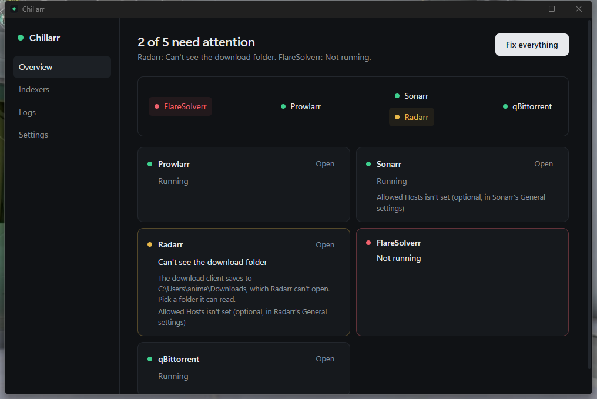

# Chillarr

Your movies, series and anime in one app. Chillarr finds things to watch, gets them, and plays them, and it keeps Prowlarr, Sonarr, Radarr, FlareSolverr, qBittorrent and Jellyfin running and fixed with one button.



## What it does

- **Watch.** A Home screen with Continue Watching, Recently Added, what's downloading, and recommended movies, series and anime. Play in Chillarr, or in VLC for the original file at full quality. Where you stop is remembered either way.
- **Get it.** Anything recommended or found in search is one click away from Radarr or Sonarr. Anime goes to your Anime folder.
- **Stream to other devices.** Jellyfin serves your library to the Jellyfin app on your phone or TV, on your Wi-Fi, or anywhere through Tailscale. No cloud.
- **First-run setup.** Asks where movies, series and anime go, sets up Jellyfin, and suggests good sources (1337x, and Nyaa.si for anime).

- **Fix everything.** One press does all of this:
  - Starts whatever is down.
  - Tests every indexer in Prowlarr and pushes them to Sonarr and Radarr.
  - Re-tests them in Sonarr and Radarr too, so their old "failed" marks clear.
  - Shows you what still doesn't work, in plain words.

  No more opening each app and pressing Test three times.
- **Keeps watch.** Chillarr sits in the tray and checks every minute. If something goes down, it brings it back and tells you with a notification.
- **No console window.** FlareSolverr runs hidden.
- **Installs what's missing.** If an app isn't installed, Chillarr asks first, then installs it from the official source:
  - Sonarr, Radarr, Prowlarr and qBittorrent come through Windows Package Manager.
  - FlareSolverr comes from its GitHub release, checked against GitHub's fingerprint.
- **Gets downloads into your library.** When Radarr or Sonarr is installed as a Windows service, it runs under an account that can't open your Downloads folder, so finished downloads never get moved. Fix everything switches it to run as you, then imports what was stuck. It uses hardlinks, so there's no extra disk space and seeding continues.
- **One view of every indexer** across all three apps.

## Install

Download `Chillarr_x.y.z_x64-setup.exe` from [Releases](../../releases) and run it. There is also a portable `Chillarr-portable.exe`.

The build isn't signed yet, so Windows SmartScreen may warn the first time. Click "More info", then "Run anyway".

## What it changes on your PC

Chillarr only changes things when you press Fix everything or Install. It asks Windows for permission (UAC) when a change needs it.

| When | What |
|---|---|
| An app isn't running | Starts it. Prowlarr and Radarr installed as services may need a UAC prompt. |
| Allowed Hosts is empty in Sonarr or Radarr | Sets it to this PC's names (localhost, its computer name, its LAN address). |
| Radarr or Sonarr runs as a locked-down service | Sets the service to Manual and runs the app as you instead. Chillarr starts it when you sign in. |
| You press Install | Downloads and installs that app. |

It reads each app's API key from that app's own `config.xml`. It never stores or sends the keys anywhere.

Its own settings live in `%APPDATA%\com.viscyrius.chillarr\settings.json`, and its log in `%LOCALAPPDATA%\Chillarr\chillarr.log`.

## Build

You need Rust and the Tauri CLI (`cargo install tauri-cli`).

```
cd src-tauri
cargo test --lib
cargo tauri build
```
